# Lab 6 — Fundamentos de Linux: archivos, permisos, usuarios y procesos

**Fecha:** 22 de noviembre de 2026
**Roadmap:** 90 días de hacking ético — Fase 2, Linux y scripting (días 16–35)
**Tiempo:** 1 hora de práctica en laboratorio

## 📝 Descripción

Este laboratorio documenta la práctica de los fundamentos de Linux que todo pentester usa a diario: moverse por el sistema de archivos, controlar permisos, gestionar usuarios y grupos, y vigilar procesos. Todo se hizo con comandos reales en mi propia máquina virtual, sin teoría suelta.

La idea central: **la terminal es la mesa de trabajo de todo el PTES** — ahí corre el reconocimiento, el escaneo, el análisis de vulnerabilidades, la explotación y el reporte.

---

## 🛠️ Entorno

- **Sistema operativo:** Kali Linux 2026.2 (Rolling) en Oracle VirtualBox
- **Kernel:** 6.19.14+kali-amd64, x86_64
- **Usuario:** `kali` (uid 1000), grupos `sudo`, `wireshark`, `vboxsf`
- **Red de laboratorio:** `10.0.2.0/24` (NAT de VirtualBox, puerta de enlace `10.0.2.2`)
- **Objetivo de escaneo:** mi propio contenedor Docker, `172.17.0.2`

---

## 🚀 Desarrollo del laboratorio

### Parte 1: Sistema de archivos

Todo en Linux cuelga de `/`: mis archivos viven en `/home/kali`, la configuración del sistema en `/etc` y los logs en `/var/log`.

```bash
pwd
ls -la ~
cd /etc && ls
find ~ -name "*.txt"
cat /etc/os-release
uname -a
du -sh ~
df -h
```

- `pwd` confirmó `/home/kali`; `find` localizó mis archivos de labs anteriores: `cia.txt` y `reglas.txt`.
- Los dos siguen en **600** (`-rw-------`), como se dejaron en los Labs 4 y 5.
- Disco raíz de 79 GB con 58 GB libres; mi casa ocupa 1,2 GB.

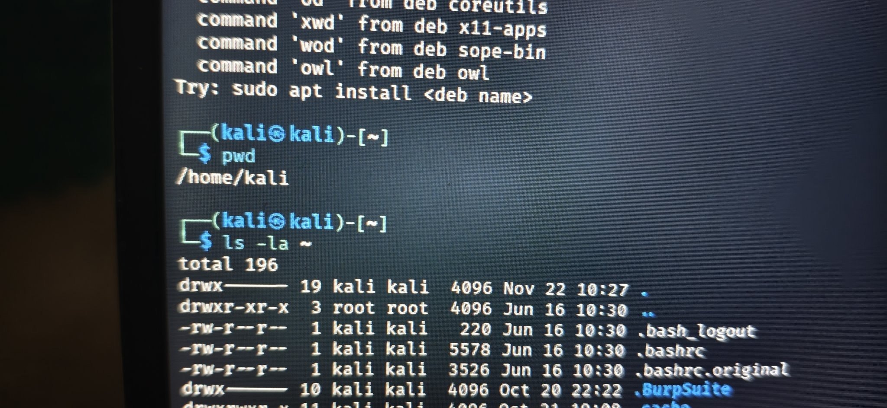
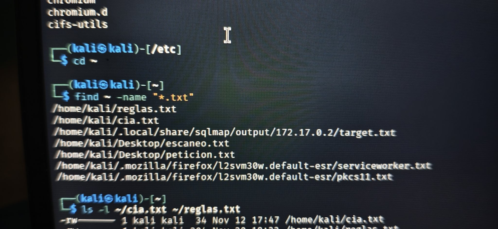
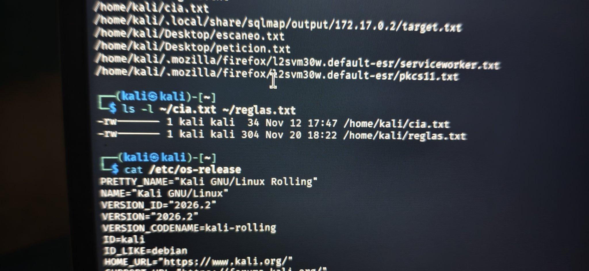
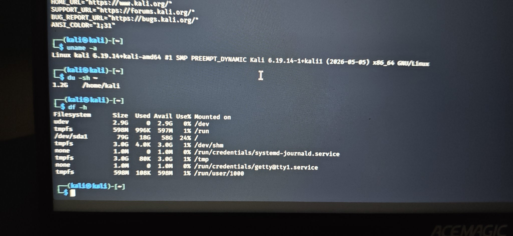

---

### Parte 2: Permisos

```bash
echo "prueba de permisos" > practica.txt
ls -l practica.txt
chmod 644 practica.txt
chmod 600 practica.txt
chmod 755 practica.txt
chmod 777 practica.txt
mkdir -p ~/lab6/{datos,scripts,logs}
chmod 600 practica.txt && rm practica.txt
```

- `practica.txt` nació en **664** porque mi `umask` es `002`: el umask decide los permisos con los que nace cada archivo.
- Pasó por `644` (`rw-r--r--`), `600` (`rw-------`) y `755` (`rwxr-xr-x`).
- El `777` (`rwxrwxrwx`) deja que cualquiera lea, escriba y ejecute ese archivo. Solo, no entrega el sistema; se vuelve fatal cuando algo que corre como `root` es escribible por cualquiera — el permiso suelto es la puerta, la ejecución privilegiada es la toma de control.

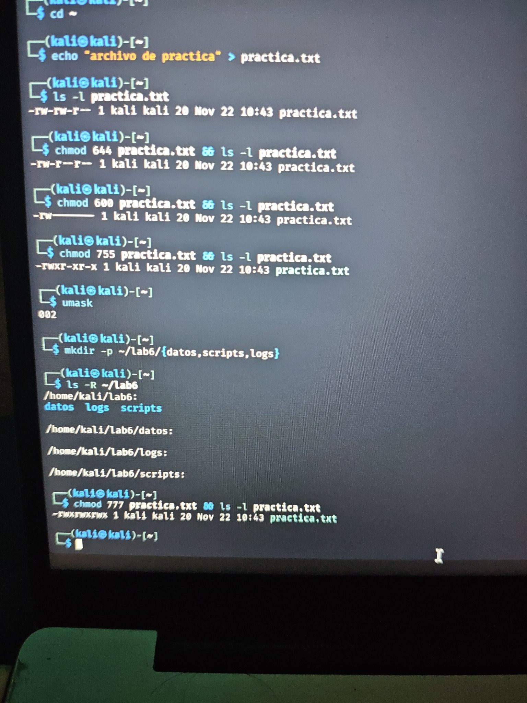

---

### Parte 3: Usuarios y grupos

```bash
whoami
id
groups
cat /etc/passwd | grep -E "kali|root"
sudo adduser invitado
su - invitado
cat /home/kali/reglas.txt
exit
sudo deluser invitado
sudo -l
```

- `id` mostró uid 1000, grupos `sudo`, `wireshark`, `vboxsf`, entre otros; `sudo -l` confirmó `(ALL : ALL) ALL`.
- La prueba viva del 600: como usuario `invitado`, `cat /home/kali/reglas.txt` devolvió **Permission denied**.
- `sudo` corre un comando como `root` con mi contraseña, sin ser `root` todo el tiempo.

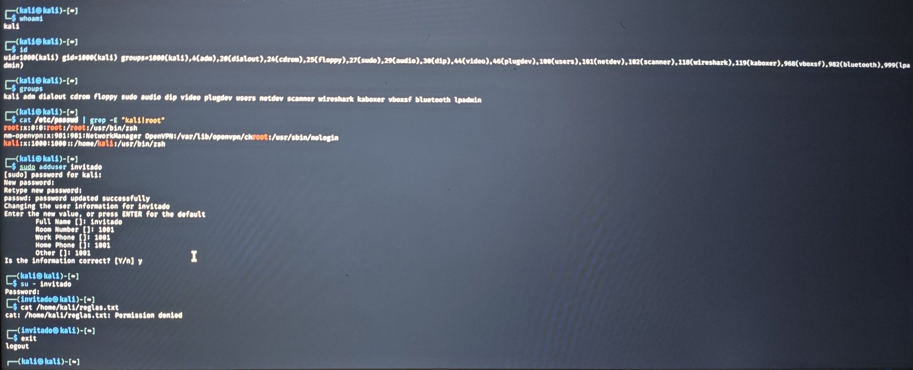
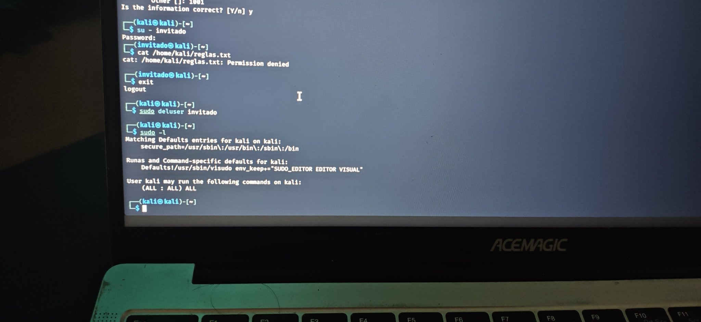

---

### Parte 4: Procesos

```bash
ps aux | head -15
ps aux | grep -i zsh
sleep 300 &
jobs
ps aux | grep sleep
kill %1
jobs
top -b -n 1
```

- `ps` muestra el estado de los procesos: **a** = los de todos los usuarios, **u** = formato orientado al usuario, **x** = también los que no tienen terminal.
- `sleep 300 &` corrió en segundo plano con PID **33150**; `jobs` lo mostró corriendo y `kill %1` lo terminó (lo mismo que `kill 33150`).
- `top`: 203 tareas, 1 corriendo, 202 durmiendo, carga 0,11.

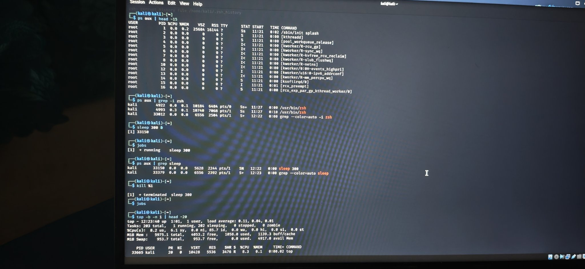
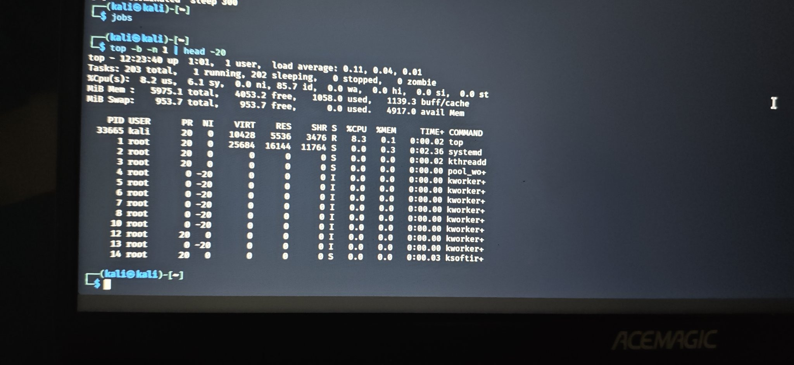

---

### Parte 5: Tuberías y filtrado

```bash
grep -i "error" /var/log/syslog
journalctl -p err
cat /etc/passwd | cut -d: -f1 | sort | head
history | tail -10
history | grep nmap
```

- Kali usa `journald`, así que no hay `/var/log/syslog`; `journalctl -p err` mostró 5 líneas viejas del 20 de octubre, ruido del gráfico `vmwgfx` de VirtualBox, nada que arreglar.
- `history | grep nmap` encontró mi propio escaneo: `nmap -p- -sS -sV --min-rate 5000 -Pn 172.17.0.2 -oN escaneo.txt`, contra mi contenedor Docker.

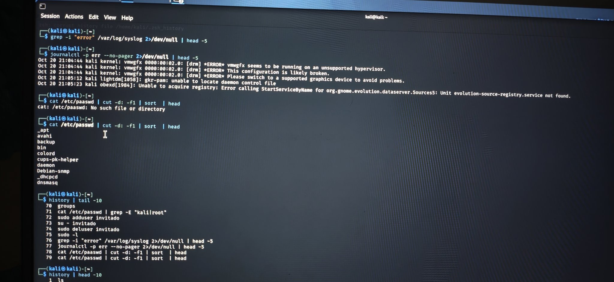
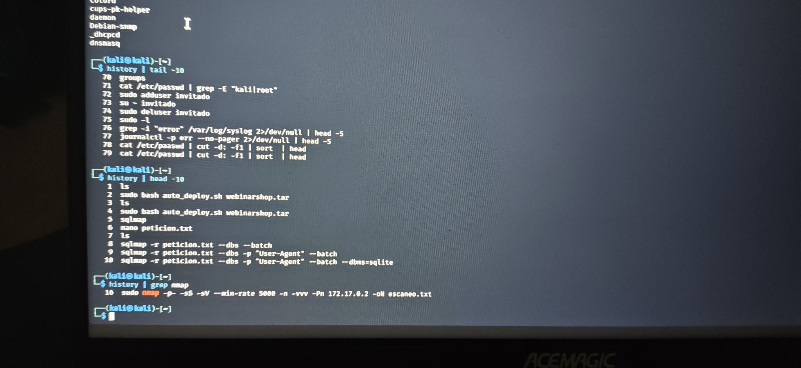

---

## 🧠 Lo que quedó claro (5 frases finales)

1. El sistema de archivos es el árbol que cuelga de `/`: mis archivos viven en `/home/kali`, la configuración del sistema en `/etc` y los logs en `/var/log`.
2. El 600 de mi `reglas.txt` significa `rw-------`, solo yo como dueño leo y escribo; el 777 sería `rwxrwxrwx`, cualquiera lee, escribe y ejecuta, por eso jamás se usa en algo real.
3. Un usuario es una identidad con su propio nivel de acceso, y `sudo` me deja correr un comando como `root`, con mi contraseña, sin ser `root` todo el tiempo.
4. Un proceso es un programa en ejecución y su PID es su número único; con `ps aux` veo los de `root` y los míos, y con `kill` detengo uno por su PID o por su trabajo.
5. Saber moverme en Linux encaja en todo el PTES: la terminal es donde corre el reconocimiento, el escaneo, el análisis, la explotación y el reporte.

## 🔧 Correcciones que me quedaron

- El sistema de archivos no es solo donde viven las configuraciones: es todo el árbol desde `/`.
- El 600 es por ser el dueño del archivo, no por ser admin.
- Un proceso no son "los movimientos": es un programa en ejecución.
- Linux no es "pentesting de acción": es la mesa de trabajo de todas las fases del PTES.

---

## ⚖️ Nota ética

Todo se hizo en mi propia máquina virtual Kali y contra mi propio contenedor Docker (`172.17.0.2`). Ningún comando tocó sistemas reales ni redes ajenas sin permiso. Esa es la regla: laboratorios y entornos propios, siempre.

## ✅ Conclusiones

1. **Los permisos son el primer control de acceso:** un 600 bien puesto vale más que cualquier herramienta, y un 777 en el lugar equivocado es una puerta abierta.
2. **Cada puerto y cada proceso tienen un dueño y un PID:** `ps`, `netstat` y `nmap` hablan del mismo sistema desde ángulos distintos.
3. **La terminal compone herramientas:** con tuberías, `grep`, `cut` y `history`, una sola línea responde preguntas que a mano tomarían minutos.
