# Lab 7 — Bash scripting para hackers

**Fecha:** 27 de noviembre de 2026
**Roadmap:** 90 días de hacking ético — Fase 2, Linux y scripting (días 16–35), días 23–27
**Tiempo:** 1 hora de práctica en laboratorio

## 📝 Descripción

Este laboratorio documenta el paso de teclear comando por comando a escribir scripts que hacen el trabajo repetitivo por mí. Un pentester vive de esto: reconocimiento, escaneos y reportes automatizados.

La idea central: **un script es una herramienta reutilizable** — lo escribes una vez y lo corres cien veces con distintos objetivos, igual que un método en programación orientada a objetos.

---

## 🛠️ Entorno

- **Sistema operativo:** Kali Linux 2026.2 (Rolling) en Oracle VirtualBox
- **Usuario:** `kali` (uid 1000), usuario normal, con `sudo`
- **Directorio de trabajo:** `~/lab7`
- **Objetivos:** `127.0.0.1` y mi propio contenedor Docker, `172.17.0.2`
- **Nota:** durante el lab el contenedor estaba apagado — `sudo docker ps` no devolvió ninguna fila — así que los chequeos contra `172.17.0.2` dieron cerrado, y el recon final se corrió contra `127.0.0.1`

---

## 🚀 Desarrollo del laboratorio

### Parte 1: Mi primer script — variables y argumentos

```bash
mkdir -p ~/lab7 && cd ~/lab7
nano hola.sh
```

```bash
#!/bin/bash
# Mi primer script
NOMBRE="kali"
OBJETIVO=$1
echo "Hola, soy $NOMBRE y mi objetivo de hoy es: $OBJETIVO"
echo "El script se llama: $0"
echo "Me pasaste $# argumento(s)"
```

```bash
chmod +x hola.sh
./hola.sh 172.17.0.2
./hola.sh
```

- `#!/bin/bash` es el shebang: le dice al sistema con qué intérprete correr el script.
- Las variables se asignan **sin espacios** alrededor del `=`.
- Con el argumento, el script reportó `Me pasaste 1 argumento(s)`; sin él, `0 argumento(s)`.
- `$1` es el primer argumento, `$0` el nombre del script, `$#` cuántos argumentos llegaron.

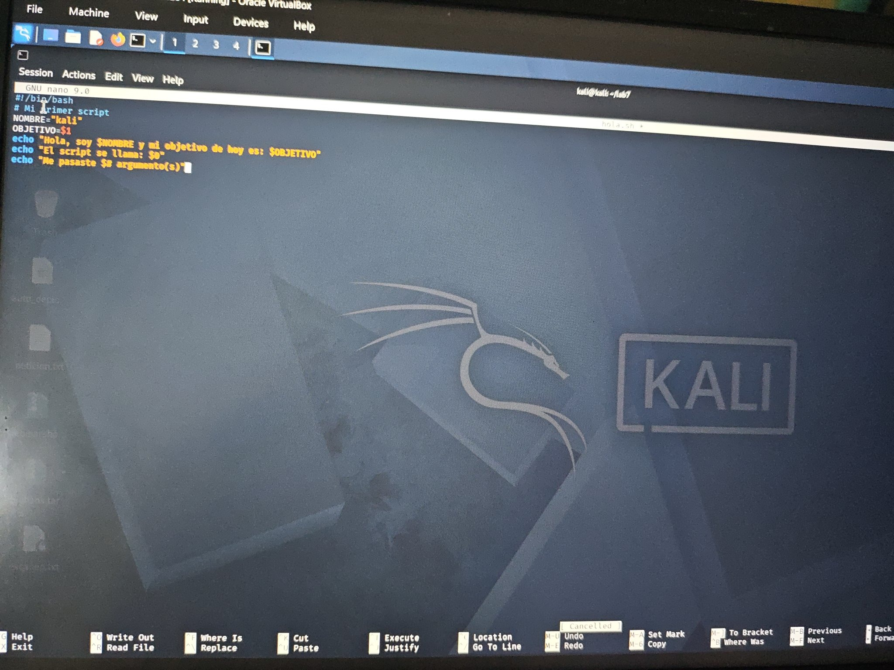
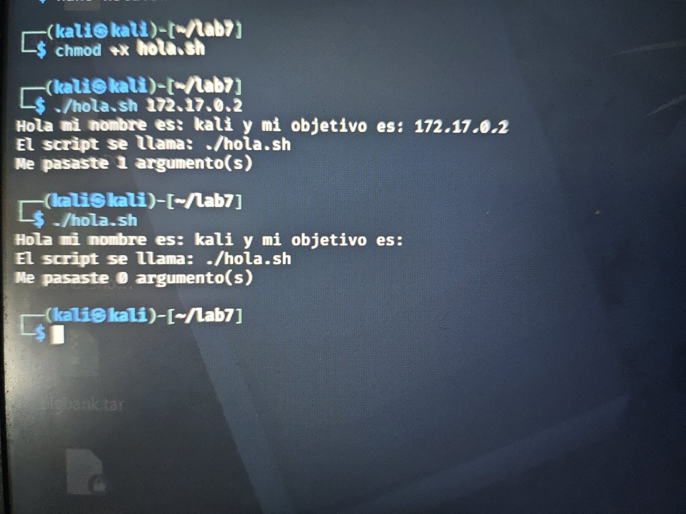

### Parte 2: Condicionales — el script que decide

`verifica.sh` comprueba si existe un archivo y si corro como root:

```bash
#!/bin/bash
ARCHIVO="$HOME/reglas.txt"
if [ -f "$ARCHIVO" ]; then
  echo "Existe: $ARCHIVO"
  ls -l "$ARCHIVO"
else
  echo "No existe: $ARCHIVO"
fi

if [ "$EUID" -eq 0 ]; then
  echo "Estás corriendo como root"
else
  echo "Estás corriendo como usuario normal (uid $EUID)"
fi
```

Resultado: `Existe: /home/kali/reglas.txt`, con permisos `-rw-------` (600, intactos desde el Lab 5), y corro como usuario normal (uid 1000).

`puerto.sh` revisa si un puerto responde sin usar nmap, con la función propia de bash `/dev/tcp`:

```bash
#!/bin/bash
# puerto.sh — revisa si un puerto responde, sin nmap
HOST=$1
PUERTO=$2
if (echo > /dev/tcp/$HOST/$PUERTO) 2>/dev/null; then
  echo "Puerto $PUERTO en $HOST: ABIERTO"
else
  echo "Puerto $PUERTO en $HOST: cerrado o filtrado"
fi
```

```bash
chmod +x puerto.sh
./puerto.sh 127.0.0.1 80
./puerto.sh 127.0.0.1 22
./puerto.sh 172.17.0.2 80
```

- Los tres dieron **cerrado o filtrado**: en Kali no corren Apache ni SSH por defecto, y el contenedor estaba apagado.
- La prueba de que el script distingue abierto de cerrado: levanté un servidor temporal con `python3 -m http.server 8000 --bind 127.0.0.1 &` y `./puerto.sh 127.0.0.1 8000` respondió **ABIERTO**. Luego lo apagué con `pkill -f "http.server 8000"` (`[1] + terminated`).
- ⚠️ Trampa real: `/dev/tcp` solo existe en **bash**. Mi terminal interactiva es **zsh**, así que probarlo directo en el prompt falla; dentro del script funciona porque el shebang lo corre con bash. El intérprete del script y el de la terminal no son lo mismo.
- `docker ps` sin `sudo` dio *permission denied*: el socket de Docker solo lo puede tocar root o el grupo docker. Con `sudo docker ps` se confirmó que no había ningún contenedor corriendo.

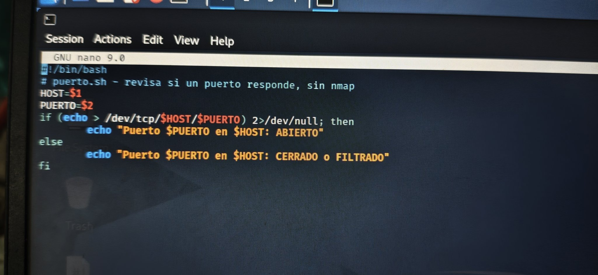
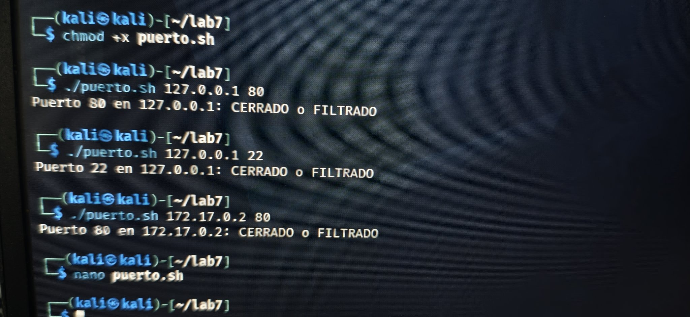
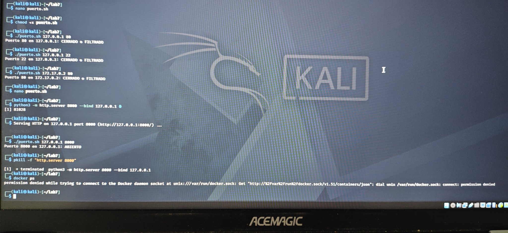
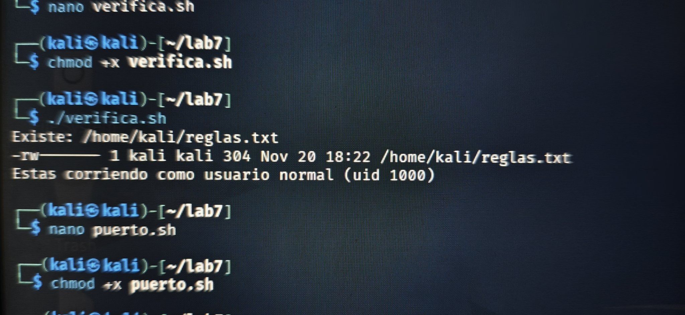

### Parte 3: Bucles — repetir sin morir en el intento

Un `for` que revisa varios puertos con el script anterior:

```bash
for p in 22 80 443 3306 8080; do
  ./puerto.sh 127.0.0.1 $p
done
```

- Los 5 puertos en `127.0.0.1` dieron cerrado. Una sola línea hizo el trabajo de 5 comandos manuales.

Un `while` que lee un archivo línea por línea (las primeras 5 líneas de `/etc/passwd`):

```bash
head -5 /etc/passwd > ~/lab7/usuarios.txt
while read -r linea; do
  echo "Usuario: $(echo "$linea" | cut -d: -f1)"
done < ~/lab7/usuarios.txt
```

- Resultado: `root`, `daemon`, `bin`, `sys`, `sync`. El `while read` procesa el archivo línea por línea.

Y un `for` sobre archivos, como en el Lab 6 pero automático:

```bash
for f in ~/lab6/*; do
  echo "--- $f"
  ls -l "$f"
done
```

- `datos`, `logs` y `scripts` salieron en `total 0`: están vacíos desde el Lab 6, no había nada que listar.

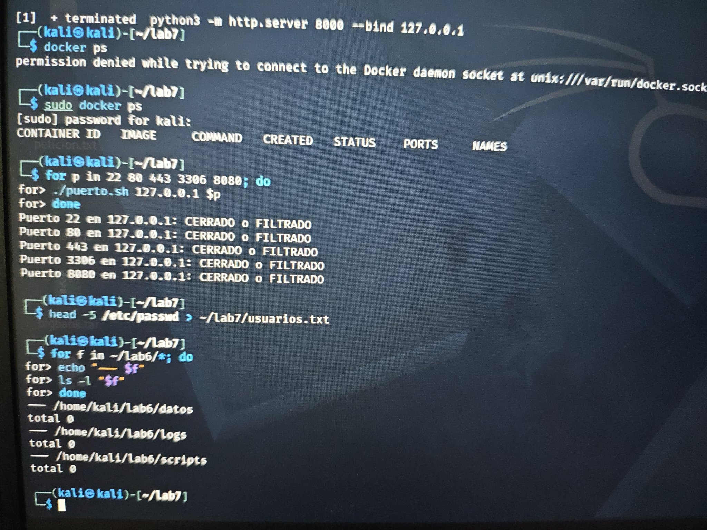
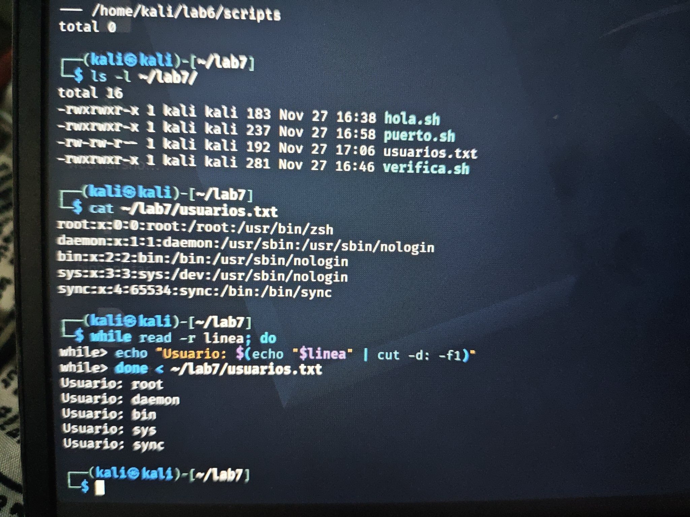

### Parte 4: Funciones — mi caja de herramientas

```bash
#!/bin/bash
# Una función recibe sus argumentos como $1, $2... dentro de ella

escanear() {
  local host=$1
  local puerto=$2
  if (echo > /dev/tcp/$host/$puerto) 2>/dev/null; then
    echo "[+] $host:$puerto ABIERTO"
  else
    echo "[-] $host:$puerto cerrado"
  fi
}

echo "Escaneando tu contenedor 172.17.0.2..."
escanear 172.17.0.2 22
escanear 172.17.0.2 80
escanear 172.17.0.2 443
escanear 172.17.0.2 3306
```

```bash
chmod +x funciones.sh
./funciones.sh
```

- Los 4 puertos del contenedor salieron `[-] CERRADO`, lo esperado con el contenedor apagado.
- La función agrupa lógica reutilizable y `local` limita las variables a la función. Comparado con el Lab 2, esto es un mini-nmap hecho por mí, puerto por puerto.

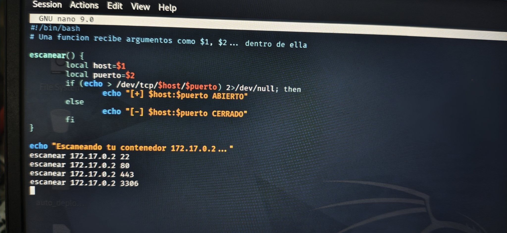
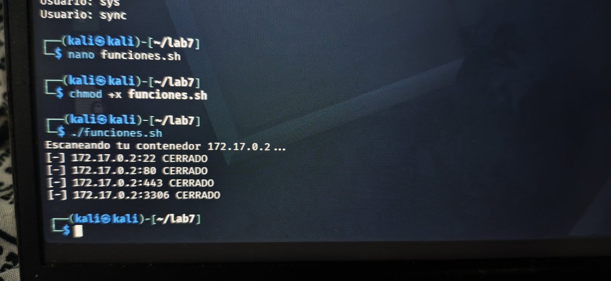

### Parte 5: Automatizar recon — mi primer script de reconocimiento

Juntando todo en `recon.sh`:

```bash
#!/bin/bash
# recon.sh — recon básico automatizado, solo para mis propias máquinas y objetivos
OBJETIVO=${1:-172.17.0.2}
FECHA=$(date +%Y%m%d-%H%M)
LOG="$HOME/lab7/recon-$FECHA.log"

echo "=== Recon de $OBJETIVO — $(date) ===" | tee "$LOG"
echo "--- ping ---" | tee -a "$LOG"
ping -c 2 "$OBJETIVO" | tee -a "$LOG"
echo "--- nmap rápido ---" | tee -a "$LOG"
nmap -F "$OBJETIVO" | tee -a "$LOG"
echo "=== Fin. Log guardado en $LOG ===" | tee -a "$LOG"
```

```bash
chmod +x recon.sh
./recon.sh 127.0.0.1
ls -l ~/lab7/
grep -i "open" ~/lab7/recon-*.log
grep -c "open" ~/lab7/recon-*.log
```

- `${1:-172.17.0.2}` significa "usa el primer argumento, y si no me das ninguno, usa 172.17.0.2". Como el contenedor estaba apagado, lo corrí contra `127.0.0.1`.
- Ping 2/2, 0% de pérdida. Nmap 7.99: los 100 puertos escaneados en localhost salieron cerrados, en 0.14 segundos.
- El log quedó guardado en `recon-20261127-1749.log` (786 bytes). `tee` muestra en pantalla **y** guarda en el log a la vez.
- `grep -c "open"` dio **0**: el reporte es honesto, nada escucha ahorita. Cuando el contenedor esté arriba, el mismo script va a detectar sus puertos abiertos.

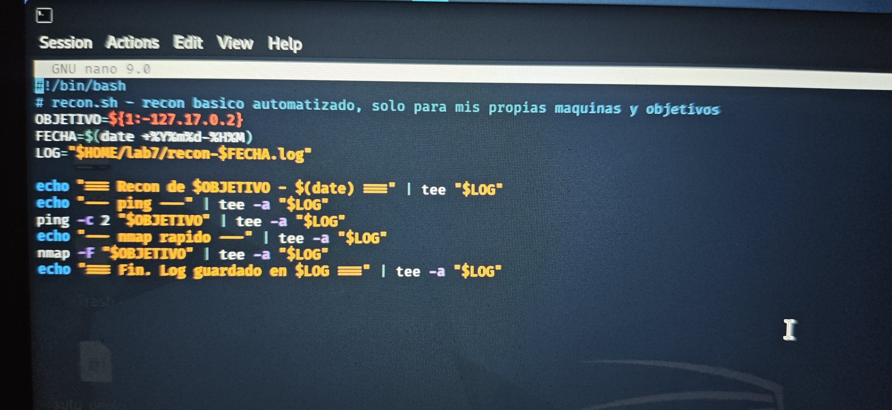
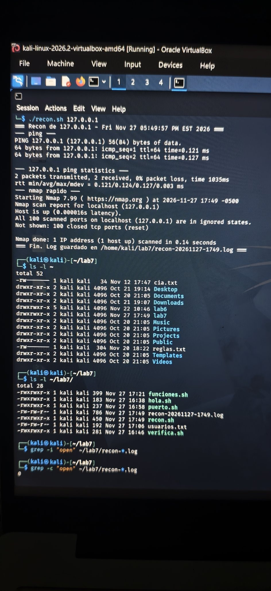

---

## 📌 Lo que aprendí (5 frases)

1. Un script de bash es un archivo con comandos que automatiza tareas, y el shebang `#!/bin/bash` le dice al sistema que lo corra con el intérprete bash.
2. `$1` es el primer argumento que le pasas al script y `$#` es cuántos argumentos llegaron.
3. Uso `if` cuando hay que decidir (¿existe `reglas.txt`? ¿responde el puerto?) y `for` cuando hay que repetir lo mismo varias veces (revisar 5 puertos, listar archivos).
4. Una función agrupa lógica reutilizable: `escanear()` se llama 4 veces con distinto puerto sin reescribir el chequeo, como un método en POO.
5. Este lab es Fase 2 de PTES: `recon.sh` automatiza la recolección de información con ping y nmap, y el log ya es un primer reporte.

### Correcciones que me llevé

- El shebang no tiene nada que ver con nano: nano es solo el editor; el shebang elige el intérprete que ejecuta el script.
- `$1` no es "asignar una variable": es el primer argumento que llega; `$#` es la cantidad de argumentos.
- `recon.sh` automatiza la Fase 2 (recolección de información) de PTES, no la 4 ni la 7 — aunque el log es un mini-reporte (Fase 7) y los scripts sirven en todas las fases.

---

## ⚖️ Ética y alcance

Todo corrió únicamente en mis propias máquinas: mi Kali en VirtualBox y mi propio contenedor Docker. Ningún escaneo salió de mi laboratorio.

---

## ✅ Conclusiones

- Dejé de repetir comandos a mano: un `for` revisa 5 puertos, una función escanea 4, y `recon.sh` hace ping + nmap + reporte en una sola corrida.
- Aprendí a distinguir cuándo un resultado "cerrado" es un error del script y cuándo es la realidad del objetivo — la prueba del servidor en el puerto 8000 lo demostró.
- El siguiente paso es el Lab 8 (Python para seguridad), donde lo mismo que hice hoy en bash lo haré en Python, con sockets reales.
